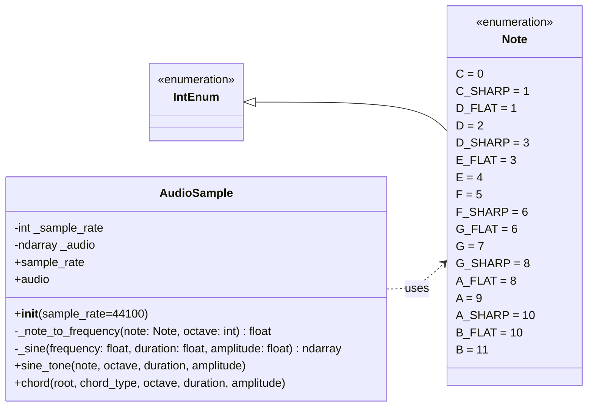

# Jon Macey Software Engineering for Media Sample Assignment

I will be developing an idea for the SEM assignment weekly to demonstrate the processes of doing the assignment.

To start with I will develop my initial idea below then start implementing it. When I start the development process I will live stream this and upload links to the streams etc.

## Project Idea

I am quite interested in Neural amp modeling https://github.com/sdatkinson/neural-amp-modeler which is a project that uses neural networks to model the response of an amplifier. For my project I am going to do something similar but try to work on simple effects first rather than full amp models.

The idea is I will start with a simple effect such as a distortion and then work my way up to more complex effects.

### Training Data

I have the ability to create my own training data as I have a few pedals and instruments I can use to record audio for training. I will also generate synthetic data to start with to produce a simple proof of concept then work on the more nuanced models to add controls and more dynamics.

### Getting started

After my initial experiments I have been able to generate a simple tone I have decided to convert this into a simple module / class as follows



### Note

- sample_rate: read/write property
- audio: read-only property setter raises NotImplementedError
- _audio initially None
- chord() uses module-level CHORD_TEMPLATES

```python
CHORD_TEMPLATES = {
    "major": frozenset((0, 4, 7)),
    "minor": frozenset((0, 3, 7)),
    "diminished": frozenset((0, 3, 6)),
    "augmented": frozenset((0, 4, 8)),
    "dominant7": frozenset((0, 4, 7, 10)),
    "major7": frozenset((0, 4, 7, 11)),
    "minor7": frozenset((0, 3, 7, 10)),
}
```

## Training sample GUI

I am building a PySide6 / QML tool to prepare training sessions. Run it from
this folder with:

```bash
uv run training_tool/app.py
```

Choose the mixer input from the combo box (Refresh finds newly connected
devices). Mixer discovery, channel scanning and recording live in
`training_tool/mixer.py`. The old `experiments/from_mixer.py` command forwards
to this file.
The input's channel count and default sample rate appear alongside its name.

Set the number of pedal controls (0–16), edit the labels and turn the dials to
match the physical pedal. Positions use a normalised 0–1 value, shown as a
percentage. Changing the count preserves the remaining controls. Reducing it
removes controls from the end.

Add a folder to list its WAV, FLAC, AIFF and OGG files, then tick the samples
to use. We can add several folders; duplicate paths are ignored. The list shows
duration, channels and sample rate, with the full path available on hover.
Unreadable audio is skipped and reported. Folder loading does not recurse
into subfolders.

This first version prepares the session in memory. The dials describe the
physical settings; they do not turn the pedal's knobs. Playback, recording,
automated capture and saving sessions are still to come.

The Python state lives in `training_tool/session.py`, the Qt interface in
`training_tool/backend.py`, and the screen in `training_tool/qml/Main.qml`.
This keeps the session usable independently of the GUI as we add capture.

We can also copy the `training_tool/` folder elsewhere and run `uv run app.py`
from inside it. The script declares its dependencies for uv and finds its QML
relative to the script. It does not need the repository or `experiments/`.

Run the tests with:

```bash
uv run --all-packages python -m pytest
```

The GUI tests run offscreen and do not need an audio device. Sample-folder
tests use real audio files, and a QML interaction test clicks a sample row to
check selection through to the session. App tests live in `training_tool/tests/`;
launch tests also check a copied app folder outside the repository.

## Next Steps

After the initial proof of concept I will move on to other effects such as reverb, delay, modulation (tremolo etc).

```

```
