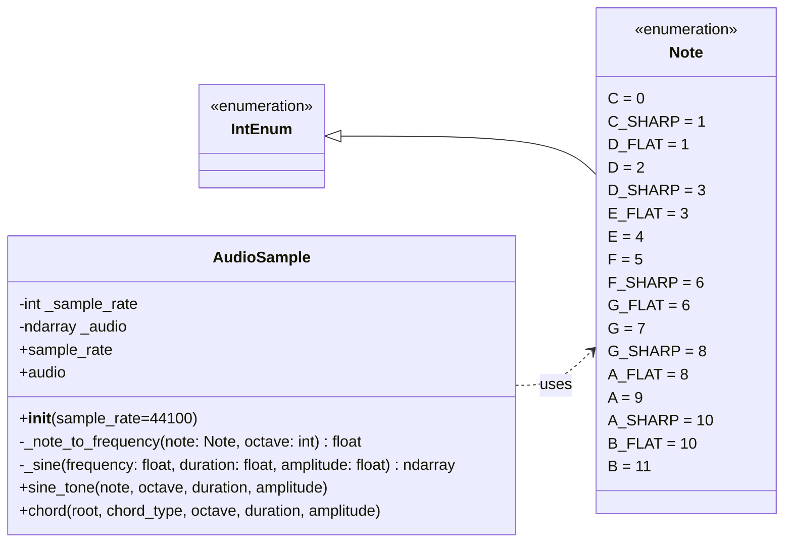

# Jon Macey Software Engineering for Media Sample Assignment

I will be developing an idea for the SEM assignment weekly to demonstrate the processes of doing the assignment.

To start with I will develop my initial idea below then start implementing it. When I start the development process I will live stream this and upload links to the streams etc.

## Project Idea

I am quite interested in Neural amp modeling https://github.com/sdatkinson/neural-amp-modeler which is a project that uses neural networks to model the response of an amplifier. For my project I am going to do something similar but try to work on simple effects first rather than full amp models.

The idea is I will start with a simple effect such as a distortion and then work my way up to more complex effects.

### Training Data

I have the ability to create my own training data as I have a few pedals and instruments I can use to record audio for training. I will also generate synthetic data to start with to produce a simple proof of concept then work on the more nuanced models to add controls and more dynamics.

### Getting started

After my initial experiments I have been able to generate a simple tone I have decided to convert this into a simple module / class as follows



### Note

- sample_rate: read/write property
- audio: read-only property setter raises NotImplementedError
- _audio initially None
- chord() uses module-level CHORD_TEMPLATES

```python
CHORD_TEMPLATES = {
    "major": frozenset((0, 4, 7)),
    "minor": frozenset((0, 3, 7)),
    "diminished": frozenset((0, 3, 6)),
    "augmented": frozenset((0, 4, 8)),
    "dominant7": frozenset((0, 4, 7, 10)),
    "major7": frozenset((0, 4, 7, 11)),
    "minor7": frozenset((0, 3, 7, 10)),
}
```

## Next Steps

After the initial proof of concept I will move on to other effects such as reverb, delay, modulation (tremolo etc).

```

```
